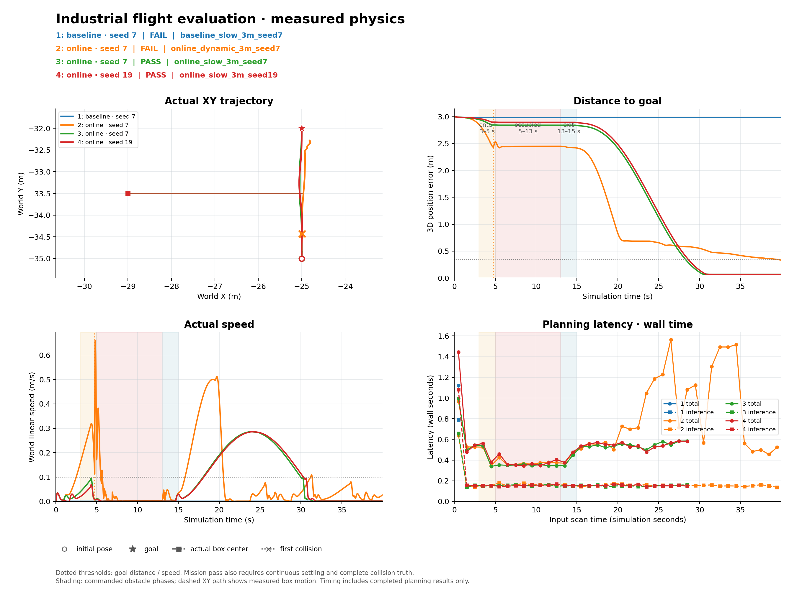

# 工业环境中的 DiT 在线规划实验

本分支保留 v003 权重，新增在 Isaac Sim 工业场景中的实际物理飞行评测和当前 LiDAR 条件的在线规划原型。它调用原 HNUTER SE(3) 控制器及真实 Newton/MuJoCo 执行器，不通过写无人机位姿播放轨迹。

## 运行

依赖同机的 `isaacsim-industrial-reactor` 仿真仓库及已经构建的 `isaaclab-sim:6.0.0-nvblox` 镜像。主仿真与 Torch 模型推理使用独立 Python 进程，避免 Isaac 旧 ML 扩展污染模型依赖。该镜像是外部本机依赖，不随仓库分发；在已有基础 Isaac 镜像的机器上，可在仿真仓库运行 `./tools/build_perception_image.sh` 构建它。验证使用的仿真仓库提交为 `c6b19ae21b22224a779c413f24c76df26abb5c05`，未修改该仓库的控制器或资产。

```bash
# 现有 v003 + 首次规划时的静态雷达条件，40 秒物理基线。
./run_industrial.sh --headless --mode baseline --goal -25 -32 2.2 --duration 40 --dynamic-obstacle --seed 7

# 当前雷达条件 + 低噪声 DiT 修正 + 执行前检查。
./run_industrial.sh --mode online --goal -25 -32 2.2 --duration 40 --seed 7

# 加入一个真实位置执行器驱动的移动箱体。
./run_industrial.sh --mode online --goal -25 -32 2.2 --duration 40 \
  --dynamic-obstacle --seed 7
```

默认目标为实际起点沿世界 +Y 前进 3 m；这是当前工业入口有观测的局部测试方向，其他起点需指定目标。

可通过 `--sim-root /path/to/isaacsim-industrial-reactor` 或 `HNUTER_SIM_ROOT` 指定仿真仓库。`--headless` 跳过 GUI；`--camera fpv|follow` 选择视角，`--capture-views` 导出最终两个真实渲染视角。`--output` 指定结果目录，默认每次独立创建目录。`--max-speed` / `--max-acceleration` 控制轨迹限速和限加速度，默认 0.3 m/s、0.4 m/s²，保护制动加速度上限 0.6 m/s²。启动脚本退出码 `0` 表示到达且无碰撞；失败返回非零。`report.json` 的 `completed`、`passed`、`error` 区分正常评测未到达和实现/依赖错误（Isaac 的 Python 启动器可能将非零码统一为 `1`）。

## 既有模型与在线适配的区别

基线直接调用 `DiTModelRuntime.sample`：8 个候选、25 步 DDIM、最后 8 步既有 smooth guidance。输入是首次规划扫描编码出的 32 个保守障碍盒，之后不更新条件。原模型输出 128 个无时间位姿点；新的时间参数化模块增加连续位置/姿态、解析速度/加速度和限速，闭环跟踪由原物理控制器完成。

在线模式以最新扫描重新构建条件。ROI 内所有回波由最多 32 个 AABB 保守包围，槽位不足时合并，不随机丢弃近障碍。盒子表示实测表面，不表示完整物体，也不表示盒子之外为空闲。

直接用工业表面盒输入原模型出现严重分布偏移，因此在线模式从明确的直线和侧向/上方弧线候选开始，用同一个 v003 网络执行低噪声 DDIM 局部修正。每步都将当前扫描的盒子输入 Cross-Attention，并使用已有碰撞 guidance。位移拟合到少量 B 样条控制点，限制偏离初始候选的幅度，并固定沿起终点连线的单调进度以防止回折。修正乘以端点光滑包络，保留初始候选的起终点切线；姿态限定为起终姿态插值，丢弃网络的大幅姿态预测。

这是**既有权重的在线适配与约束**，没有训练新权重，也没有证明网络学会移动障碍预测。候选初始几何由程序构造；报告记录实际网络调用次数、网络修正量和 guidance 位移，不能把手工初始候选称为模型原创规划。

## 调度与保护

物理控制始终为 1 ms。每 100 步读取真实 MID-360 近似传感器，扫描与位姿同一时刻；规划在独立推理进程和后台调度中执行，最多一个在途请求。在线尝试按 1 秒仿真间隔重规划；已经验证且仍可执行的轨迹会继续使用，避免每次重新从静止起步。

原始和时间参数化后的候选都检查 42 球与当前实测障碍盒的距离。段间按平移和转角细分，包含端点。执行期间检查当前观测中的短程路径；未知方向或新障碍触发有限加速度制动，起点偏移超过 0.05 m、姿态漂移超过 0.1 rad 或扫描过期的计划不得接管。在线规划超过 2 秒墙钟期限时独立触发制动，迟到结果丢弃；worker 异常则锁存失败并保持。没有回波的方向保持未知，不用最大测距补成空闲。

完整扫描按最近发射射线判断，包括未返回的射线；最近射线无回波仍视为未知，不能用旁边的回波补全。实测近似扫描存在约 2° 的角间隙，因此采用最大 3° 且横向距离不超过 0.05 m 的有限分辨率判据（只有回波点、没有完整射线的输入保留 1.5°）。这仍是近似证据，而不是连续空间观测证明。

可见性检查只检查采样的传感器中心线，并排除当前传感器周围 0.1 m 邻域；它不证明整机体积已被观测。42 球也是已有近似代理，不能代替碰撞真值或真实飞行安全认证。日志单独记录未观测比例、拒绝原因、停止次数与观测年龄。

## 公平的物理评测

本次使用完整工业场景，但航线位于初始位置附近的建筑外侧，未评测厂房内部穿越。工业场景的真实碰撞几何只交给评测器，不用于规划条件。GPU 模式每一个物理步读取当前 `mjw_data.contact`，区分机器人/环境接触，排除自碰撞与正接触 margin，并锁存首次真实接触。CPU 模式读取原生 MuJoCo 当前接触。成功要求目标误差不超过 0.35 m、速度不超过 0.10 m/s 且连续保持至少 0.5 秒，同时整个运行无碰撞。

移动箱体位于起点到目标的中点，通过真实滑轨位置执行器沿水平垂线运动：起初偏离路线 4 m，3–5 秒进入路线，5–13 秒挡路，13–15 秒退出。箱体真实位置、接触与雷达回波由同一物理模型产生；计划器不知道运动时间表。当前此测试装置仅支持沿世界 X 或 Y 的目标。

`report.json` 记录完整步数、到达/接触、推理与整个规划耗时、候选长度/净空、条件扫描哈希、观测和激活时间；`trajectory.json` 保存真实飞行与参考；`first_lidar.npz` / `last_lidar.npz` 保存实际扫描。原始输出在忽略的 `results/` 下。

## 2026-10-04 实测记录

原始 v003 在一份真实工业回波条件下，为 4 m 目标生成 52.48–63.69 m 的路径，最大滚转超过 165°；加入时间参数化后难以有效完成短程任务。真实物理基线也出现候选全部与观测代理相交，或选中很长、很慢的路径。独立进程验证见 [isolated_inference_validation.json](isolated_inference_validation.json)；其中在线采样数字属于开发初期 v1，最终版本是带单调进度和端点切线约束的 v3。

最终飞行记录见 [industrial_validation.json](industrial_validation.json)。测试使用一个固定的横穿箱体，控制器和物理参数保持原有设置；速度限制是本轮开发调整所得，不是独立测试集上的泛化指标。

| 条件 | 结果 | 最终目标距离 | 首次稳定到达 | 真实碰撞 |
| --- | --- | ---: | ---: | --- |
| 原模型，3 m，0.3 m/s，seed 7 | 失败：无可执行候选 | 2.986 m | — | 无 |
| 在线，2 m，0.5 m/s，seed 7 | 失败：发生碰撞 | 0.019 m | — | 有 |
| 在线，3 m，0.5 m/s，seed 7 | 失败：发生碰撞 | 0.335 m | — | 有 |
| 在线，3 m，0.3 m/s，seed 7 | 通过 | 0.070 m | 30.479 s | 无 |
| 在线，3 m，0.3 m/s，seed 19 | 通过 | 0.067 m | 30.811 s | 无 |

每轮均完成 40,000 个 1 ms 物理步，并逐步检查接触。两个低速种子均在约 4.2 s 制动，5–13 s 障碍阻挡期间保持，退出后恢复；跨过路线中点发生在障碍撤走之后。平均完整规划耗时分别为 0.488 / 0.515 s，平均网络推理 0.170 / 0.186 s。40 s 仿真的控制循环分别用了 92.0 / 92.9 s 墙钟时间，不含启动和额外渲染，因此没有达到完整墙钟实时。

86 项测试通过，覆盖轨迹导数、连续段细分、旋转扫碰、点云坐标变换、未知射线拒绝、规划超时制动及真实接触判定。



0.5 m/s 测试中的碰撞说明：当前扫描条件、路径重验和制动不能代替障碍速度估计及未来占用预测。到达附近也不会抹掉此前碰撞，成功标记始终要求整个运行无接触。低速通过应解释为**遇障停等，障碍退出后继续前进**，不表示能够绕过横穿障碍，或已经解决任意动态场景。

[跟随视角](industrial_follow.png) / [机头视角](industrial_fpv.png) 为 `online_dynamic_3m_seed7` 高速失败测试结束时的真实渲染，仅证明模型和相机画面正常，不能作为无碰撞飞行证明。

```bash
# 单元测试（需要 numpy、scipy、torch、pytest）
python -m pytest -q
# 从原始结果重新汇总或绘图
python tools/summarize_industrial.py results/industrial/online_slow_3m_seed7
python tools/plot_industrial.py results/industrial/online_slow_3m_seed7 \
  --output results/industrial/online_slow_3m_seed7.png
```

原始日志、轨迹、点云和 worker 证据保留在本地 `results/`，不纳入 Git；Git 中保存紧凑验证 JSON 和图片。首次在主 Isaac 进程直接推理时发生 Torch 版本混用错误，已经由隔离 worker 修复；该次是基础设施失败，不计作模型飞行性能。

## 适用范围

- 使用仿真真值位姿，未集成 SLAM；只有当前扫描，没有遮挡目标追踪或运动预测。
- 点云是当前仿真仓库的 MID-360 视场/量程近似，非厂商精确扫描、噪声或 IMU 模型。
- 32 盒压缩可能填平可通行间隙；有限的初始路径族和局部修正无法覆盖任意拓扑，单调进度约束也排除了需要后退的路线。
- 未观测开阔方向可能持续保持；这是覆盖不足，不是到达成功。
- 10 Hz 感知和 1 Hz 重规划以仿真时间计。仅推理耗时低于周期不等于整个 Isaac 仿真达到墙钟实时。
- 该原型限制姿态，以验证低速平移规划；没有训练或验证新的完整六自由度动态环境策略。
