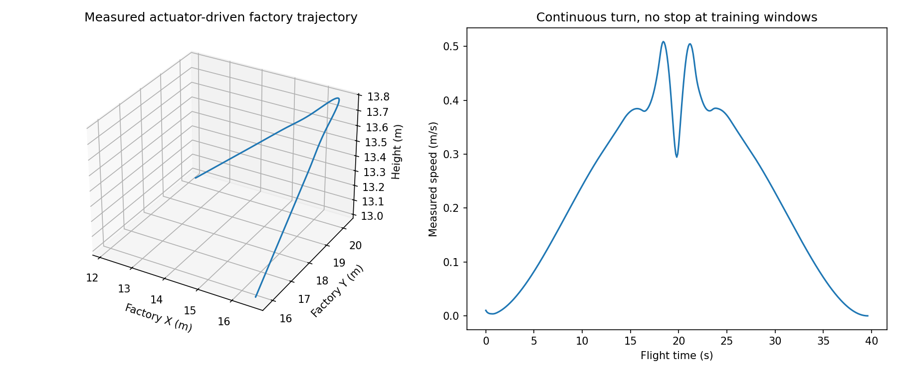

# Real factory geometry with causal nvblox expert windows

This extension reads `HNUTER_trajectory_collector` as an external dependency and uses its **OMPL RRTConnect and full rigid URDF/COAL checker**, rather than the former 21 hand-shaped trajectory candidates. The reference collector is not modified, and no full campaign is launched. Its original batch data are untimed geometric paths; this bridge adds explicit retiming, original-actuator rollout, live ray acquisition, causal nvblox maps and a training-only input whitelist.

## Three audited stages

1. **Geometry:** load all triangles from the simulator's `_build/collision.npz`. Export an unchanged PLY for COAL: no box approximation, convex hull or decimation. Public mission positions specify task waypoints. OMPL finds each connecting route; concatenate its geometry before fitting one spatial cubic spline. Coarsen interpolation knots to approximately 0.8 m so dense RRT points do not impose an almost sharp corner. A global quintic clock has zero endpoint speed/acceleration only at the whole-flight endpoints. Recheck 2,001 samples against the original mesh; reject failed smoothing instead of silently flying an invalid curve. Uniform retiming limits sampled speed/acceleration/angular speed. This is not TOPP-RA or an optimal time parameterization.
2. **Rollout/sensing:** unchanged HNUTER native MuJoCo actuators at 1 ms. Every measured pose is independently checked with the collector's full URDF collision primitives against the factory mesh with a 0.15 m safety margin. The industrial mesh is **not** added to native MuJoCo as a convex object: factory collision response is not simulated in this stage. A failed external mesh check stops and rejects the run. A Warp triangle-ray sensor obtains 20,000 real intersections at 10 Hz, with the existing MID-360 field of view and mount. It uses simultaneous measured pose, not reference pose. Scene geometry, LiDAR and collision checker share exact world coordinates and source hash.
3. **Training windows:** every second in motion, record current measured linear/angular velocity, quaternion and current reference acceleration. Predict a 4-second pose/derivative trajectory starting 100 ms later. The 100 ms delay is an explicit training design, **not a measured inference guarantee**. The public active waypoint is conditioning; OMPL path/clearance/scene labels are not. No physical stop/reset occurs at window boundaries.

A trajectory passing this bridge has passed native controller tracking and external rigid-URDF mesh validity. It has **not** passed Isaac Newton factory mesh-contact dynamics. Robot URDF primitives and native articulated collision geometry are distinct representations; no claim of exact equivalence is made. No in-flight body pose is overwritten.

## Causal sensing and frames

Each decision reconstructs a bounded map using only measured scans from the previous 5 seconds (configurable 0.6–20 s), then takes four cumulative snapshots 0.2 s apart. Reconstruction is deliberately offline and repeated per window, to keep a clear causal boundary. It is not an estimate of an incremental online mapper's latency. No episode-final map, future rays, mesh occupancy tensor, or teacher obstacles enter student inputs.

The query frame is the **current measured yaw**, anchored at current body position, and shared by all history snapshots. Position, linear derivatives and the goal are expressed in that frame; quaternions are local wxyz; angular velocity/acceleration remain body-frame. Save `world_from_local` and `origin` for reconstruction. The local grid remains 32³ with 0.25 m spacing and the six native SDF/known/hit channels. Unknown remains explicit. Simulation truth supplies pose; there is no lidar odometry, sensor noise or hardware validation.

`FactoryWindowDataset` returns only whitelisted `inputs` and separate `labels`. It verifies each NPZ hash and rejects supplied manifests assigning the same factory-mesh hash to different splits. The full current factory is one group: different flights through it do not establish held-out-scene generalization. The initial pilot is train-only. Independent sites or a rigorously isolated spatial evaluation protocol are needed for meaningful generalization testing.

The old stationary-start model is **not automatically compatible** with these moving-state inputs and delayed dense targets. This change supplies training data and a loader, not trained weights or a deployed realtime planner. The next training stage must condition the DiT on motion and delay, predict compatible derivatives, and evaluate rolling-window replacement under online measured map ages.

## Run a bounded pilot

From the HNUTER_DiT root, use a fresh output directory:

```bash
PYTHONDONTWRITEBYTECODE=1 OMP_NUM_THREADS=1 OPENBLAS_NUM_THREADS=1 \
 /home/z017/research/curobo_env/bin/python -m hnuter_dit.factory_expert_data collect \
 --sim-root /home/z017/research/isaacsim-industrial-reactor \
 --collector-root /home/z017/research/HNUTER_trajectory_collector \
 --mission configs/factory_expert_pilot_v1.json --max-duration 90 --solve-time 2 \
 --output results/factory_expert/repeat --split 0

docker run --rm --gpus all --ipc=host \
 --mount "type=bind,source=$PWD,target=/dit" \
 --mount type=bind,source=/home/z017/research/isaacsim-industrial-reactor,target=/sim,readonly \
 -e LD_LIBRARY_PATH=/opt/nvblox-venv/lib/python3.12/site-packages/nvidia/npp/lib \
 -e OMP_NUM_THREADS=2 -e OPENBLAS_NUM_THREADS=1 -e PYTHONDONTWRITEBYTECODE=1 \
 --workdir /dit --entrypoint /opt/nvblox-venv/bin/python isaaclab-sim:6.0.0-nvblox \
 -m hnuter_dit.factory_expert_data prepare --sim-root /sim \
 --source results/factory_expert/repeat --output results/factory_expert/repeat_mapped
```

```python
from hnuter_dit.factory_window_dataset import FactoryWindowDataset
samples = FactoryWindowDataset(["results/factory_expert/repeat_mapped/mapping.json"], split=0)
# Compatible with PyTorch DataLoader's default NumPy collation.
example = samples[0]   # {'inputs': ..., 'labels': ...}
```

Keep geometry, rollout and mapping manifests linked by hashes. On failure `rollout.json` records the error; incomplete/failed rollout cannot be mapped. Partial mapping has no final manifest and is not trainable. Existing directories are never overwritten. This pilot has no automatic resume or large campaign scheduler. The reference collector's proven batch coordinator can be integrated later; it should not be used unchanged because its hot path excludes sensing and actuator rollout.

## Scope and development evidence

- Exact factory input: 2,501,013 triangles; dependency revision and file hashes are recorded in the validation report.
- First hand-chosen goal `[13,14,13]` was rejected by the full mesh checker. That failure is retained; the successful route is a development selection, not an unbiased success-rate measurement.
- Dense interpolation required an 88.5 s retiming. Coarser spatial fitting reduced the same pilot's duration to 39.6 s while retaining independent clearance and physical tracking checks; both runs are retained.
- The short pilot goes from `[16.5,15.8,13]` via `[16.5,20.2,13.8]` toward `[12.1,20.2,13]`. The route is spacious. It does not establish narrow-gap navigation, dynamic obstacle prediction, task contact, localization robustness or wall-clock model performance.
- Roll/pitch are limited to a small 0.2 rad curriculum. Current mission endpoints request identity orientation; broad 6-DoF attitude maneuver training remains outside this pilot.

See `docs/factory_expert_validation.json` for actual measured results. Raw datasets stay in ignored local results; no weights were changed.

## Final measured pilot (2026-10-06)

The final continuous route executed for 39.6 simulation seconds over 39,600 native
physics steps, travelling 8.991 m with an approximately 0.8 m rise and descent.
All 39,601 external full-URDF mesh checks passed. Maximum position/attitude tracking
errors were 0.01807 m / 0.01985 rad; terminal position error was 0.01672 m.
The run produced 397 real 20,000-ray scans and 35 moving windows. Ray acquisition
P50/P95 was 15.95/21.15 ms on the CPU backend; this excludes GPU mapping and DiT.

Official nvblox prepared all 35 windows. Latest-grid known fractions were
24.69–32.63%; unknown voxels remain masked. File hashes, causal ages, input whitelist,
local/world position/quaternion/velocity roundtrips and unchanged body angular
labels were checked. A separate plane sensor check obtained 9,461 hits with maximum
plane error 0.00001193 m. Eighteen relevant regression tests passed.

Repeated NPZ member decompression initially dominated preparation. Caching each
member once reduced offline reconstruction to about 0.2 s per window including
up to 51 integrations; this is not an online incremental update or inference benchmark.
Interrupted development mapping logs and the dependency-import failure are retained.
Final rollout sources precede preparation-only performance/timestamp fixes; both
executed rollout hashes and final source hashes are recorded separately.

Local data: `results/factory_expert_v1/rollout` and `results/factory_expert_v1/mapped`.
Use the latter's `mapping.json` with `FactoryWindowDataset`. These files are ignored
by Git. No model weights were trained or deployed in this change.


