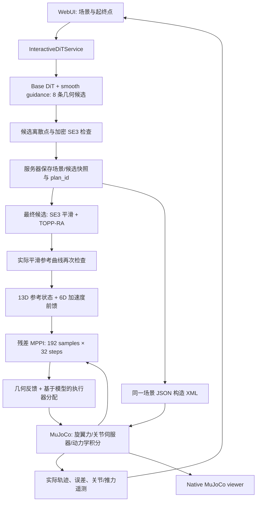
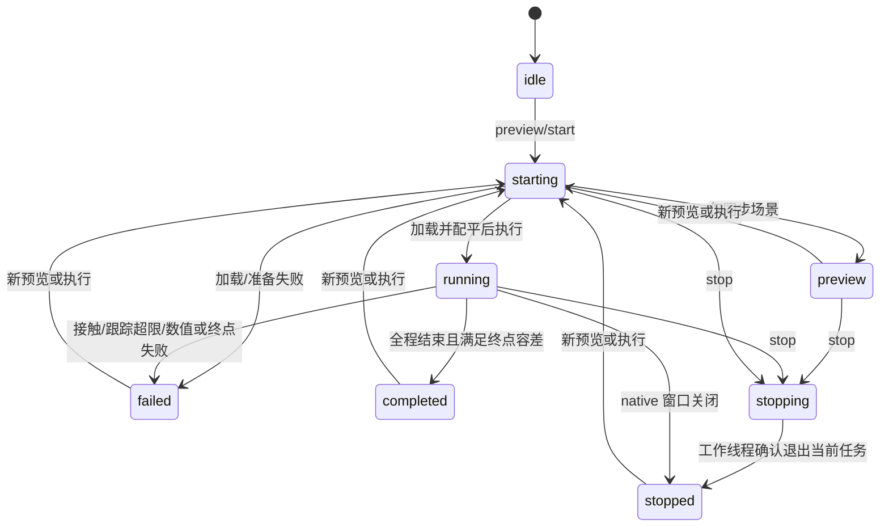

# Base DiT 交互规划与 MuJoCo 执行交接

本系统把 Base DiT 生成的几何轨迹接入 **TOPP-RA 连续时间参考、残差 MPPI、HNUTER 物理执行器与 MuJoCo**。WebUI 编辑无人机起终点位姿和随机障碍环境，一批生成 8 条 smooth-guidance 候选，自动选择可执行轨迹，也允许手工更换已通过检查的候选。MuJoCo 使用该批规划绑定的同一场景，实际运动由旋翼力和倾转关节伺服器产生。

运行状态记录：**2026-10-13，按用户要求，本机交互服务与 MuJoCo 程序已关闭**。下面的 localhost 地址是重新启动后的访问入口；交付内容是代码、规划样例和已保存的验证证据。

## 1. 代码入口与职责

| 文件 | 职责 |
|---|---|
| [run_interactive_demo.sh](../run_interactive_demo.sh) | 选择 Python 环境、设置 Matplotlib 缓存位置、启动交互服务。 |
| [interactive.py](../hnuter_dit/interactive.py) | 固定 smooth guidance / batch 8，候选复检与排序，保存场景/候选快照与 `plan_id`，提供规划和执行 API。 |
| [service.py](../hnuter_dit/service.py) | 加载默认 v003 checkpoint、调用外部场景生成器、执行 DDIM/guidance、恢复世界坐标 pose7、调用 URDF 碰撞检查器。 |
| [model.py](../hnuter_dit/model.py)、[geometry.py](../hnuter_dit/geometry.py)、[guidance.py](../hnuter_dit/guidance.py) | DiT、canonical 坐标变换与 smooth multi-cost guidance。 |
| [retiming.py](../hnuter_dit/retiming.py) | SE(3) 曲线去噪/平滑、TOPP-RA 标量进度求解、时间剖面平滑、运动学与 jerk 复检。 |
| [mujoco_execution.py](../hnuter_dit/mujoco_execution.py) | 从场景 JSON 构造 MuJoCo XML，管理仿真工作线程和 native viewer，运行残差 MPPI、记录实际运动与失败原因。 |
| [flight_control.py](../hnuter_dit/flight_control.py) | 修正速度测量与执行器分配，计算实际旋翼几何/整机质心、初始配平、限制并平滑倾转与推力指令。 |
| [web.py](../hnuter_dit/web.py)、[web_assets](../hnuter_dit/web_assets) | HTTP/JSON 与浏览器三维交互、候选/最终轨迹、执行进度和实际轨迹显示。 |
| [benchmark_interactive_flight.py](../hnuter_dit/benchmark_interactive_flight.py) | 固定已保存的规划做完整 headless 物理仿真，测量关节速度、指令变化量、跟踪误差和前后对照。 |

默认 checkpoint 是 `artifacts/base_free_flight_159103traj_dit_canonical_cross_v003/models/dit_cross/best.pt`。模型结构与训练评测见 [README](../README.md)，本文件只说明交互执行链路。

## 2. 数据流与坐标约定



| 数据 | 排列与含义 |
|---|---|
| DiT 内部轨迹 | 128 × pose9：位置 xyz + rotation-6D；模型在 yaw-aligned canonical frame 中工作。 |
| 环境 token | 最多 32 × 10：`[xyz, size_xyz, qw, qx, qy, qz]`，不把地板作为环境 token。 |
| 规划/API pose7 | 世界坐标 `[x, y, z, qw, qx, qy, qz]`。 |
| MPPI 参考/观测 13D | `[p_world(3), v_world(3), q_wxyz(4), omega_body(3)]`。 |
| 前馈及 MPPI action 6D | `[a_world(3), alpha_body(3)]`，单位分别为 m/s² 与 rad/s²。 |
| MuJoCo 实际状态 | 完整 XML 的 free joint、倾转关节、旋翼关节等 `qpos/qvel`；其维度大于 MPPI 的 13D 预测状态。 |

世界坐标采用 z 向上，四元数统一为 **wxyz**。浏览器允许用 roll/pitch/yaw 编辑姿态，但 TOPP-RA 的角运动约束使用机体系角速度/角加速度，不直接对 Euler 角或四元数分量做“关节限速”。

MPPI 的 `FullyActuatedUAVDynamics` 是加速度级预测模型，完整旋翼/倾转动力学在 MuJoCo 执行端积分。轨迹几何来自 DiT；TOPP-RA 负责其时间参数化和可跟踪参考生成。

## 3. 随机性与默认首次运行

| 设置 | 当前默认值/行为 |
|---|---|
| 场景族 | WebUI 的 `random`，按 `random.Random("family/{seed}")` 确定场景族。 |
| 场景 seed | `--scene-seed 42`；障碍数量请求范围为 8–18。 |
| 场景内初始端点 | 场景生成成功后，用条件 seed `scene_request_seed + 7919` 采样。场景不成功时，生成器最多尝试 12 个相邻 scene seed。 |
| DiT 推理 seed | 浏览器默认 `20260828`；DDIM steps 25。 |
| Guidance | 服务端固定 `smooth`、最后 8 步、一批 8 条；默认单步最大平滑位移 0.12 m。 |
| 执行随机性 | `--execution-seed 1`，用于 MPPI 的 NumPy RNG。 |

固定 seed 的复现还需要相同 checkpoint、外部场景生成器版本、输入参数、Python/数值库与设备。`family=random` 的 seed 42 在已验证环境中生成 `sparse_obb_clutter_seed_42`、13 个障碍 token；它不同于前后对照中的 `central_block_seed_42`。

随机起终点按钮会产生新的 seed。要求严格复现时，应保存完整 scene/pose/候选 JSON，而不只记录一个数字。已保存的规划样例位于 [验证证据目录](../artifacts/interactive_execution_validation)。

## 4. 规划检查、选择与快照绑定

执行前有两阶段几何检查；第一阶段包含原始离散点检查和候选折线的加密检查。

1. `DiTTrajectoryService.sample_trajectories()` 检查 128 个 waypoint 的碰撞、位置边界和姿态限制。
2. `rank_candidates()` 对合格候选的直线位置段与最短弧 quaternion SLERP 加密，默认平移间距 0.02 m、旋转间距 3°；要求起终点一致、位置/姿态仍合格、最小净空 **严格大于** 0.02 m。
3. 最终候选经 `TimedPoseReference` 平滑和 TOPP-RA 处理后，执行器调用 `reference.audit_poses()` 提取实际曲线，再通过 `validate_execution_reference()` 按 0.01 m / 1° 复检。曲线改变后不得复用原始折线的检查结论。

默认位置采样边界是 `[-3.3, -3.3, 0.65]` 至 `[3.3, 3.3, 3.5]`；场景可提供自己的 `position_bounds`。姿态要求 `|roll| <= 40°`、`|pitch| <= 70°`。检查器的实际 backend 会随结果保存：验证实验使用 `coal_full_urdf_nearest_point`。交互候选的执行资格筛选和平滑曲线复检都会调用 `_require_measured_clearance()`，拒绝外部检查器的 OBB 占位净空后备模式。

合格候选按以下分数自动选择，分数相同时取原始 index 较小者：

```text
length_m + 0.015*p95_turn_deg + 0.005*max_turn_deg
+ 2*backtracking_fraction - 0.3*min(dense_clearance_m, 0.3)
```

每次采样都会产生新的 UUID `plan_id`。服务器深拷贝保存 scene、候选、请求的起终点和条件键，浏览器只提交 `plan_id` 与可选的 `candidate_id` 来执行。执行 API 从服务器快照读取路径与环境，不采用客户端传来的替代轨迹。允许改变最终候选选择，但不修改快照中的几何路径。API index 从 0 开始，WebUI 编号从 1 开始。

生成新场景、随机新端点或重新采样会撤销旧规划。浏览器手工编辑条件后会请求验证并使旧规划失效。服务重启后内存中的 `plan_id` 消失；下载的 JSON 可用于离线 benchmark，但不能直接作为新服务的已授权 `plan_id` 使用。没有合格候选时，`final_candidate_id` 为 `null`，需要调整端点、场景或推理 seed 后重新生成。

场景几何 hash 对障碍的 id、角色、类型、位置、四元数、完整尺寸与 collision 标志计算 SHA256，并包含地板。MuJoCo 构造 XML 时移除原模型直接挂在 worldbody 下的旧静态 geom，按该 JSON 重建 OBB 和地板，将 `size_xyz/2` 写入 MuJoCo box 半尺寸。起终点标记不参与碰撞。

## 5. TOPP-RA 与平滑参考

旧版本的逐段 minimum-jerk 时间参考会在每一个 waypoint 处把速度和加速度降为零。128 个点会产生 127 次启动/停止，两个对照条件的运动时间约 53.2–57.4 秒。代码保留 `LegacyStopAtWaypointReference` 供分析；交互执行使用 [retiming.py](../hnuter_dit/retiming.py) 的 `TimedPoseReference`。

当前处理步骤：

1. 归一化四元数、连续化符号、移除相邻重复 pose。
2. 联合简化位置与旋转的小幅 waypoint 噪声，保留端点和重要弯折；使用 natural `CubicSpline` 与 `RotationSpline` 构造 C2 SE(3) 几何曲线。相对原始折线/SLERP 的设计容差为位置 0.01 m、旋转 0.015 rad，并在密集探针上检查偏差。
3. TOPP-RA 使用 `seidel` 求解标量进度 `s(t)`，首尾进度速度为零。速度约束取平移/旋转范数；加速度约束采用 26 个归一化方向组成的多面体约束并留出余量。网格至少包含 801 个均匀进度点，再加入曲线节点和中点。
4. 对 TOPP-RA 进度速度进行 sigma=0.06 s 的非负 Gaussian 平滑，使用形状保持的 PCHIP 速度插值并积分为 C2 进度；首尾有零速度/零加速度的平坦区。
5. 独立密集检查单调进度、平移/旋转速度、加速度和 jerk。必要时整体拉长时间；时间放大系数 `k` 将速度、加速度、jerk 分别缩小为原来的 `1/k`、`1/k²`、`1/k³`。

当前内部 jerk 目标为平移 15 m/s³、旋转 8 rad/s³；它们不是 CLI 参数。平移三阶导来自分段三次位置曲线，旋转三阶项使用机体系角加速度的短中心差分估计，因此结果字段标为 `estimated_*_jerk`。密集校验采用 0.98 余量；这些数值检查不等价于解析的全区间 jerk 证明。

参考满足：

```text
v = p'(s) * s_dot
a = p'(s) * s_ddot + p''(s) * s_dot²
omega_body = omega_s(s) * s_dot
alpha_body = omega_s(s) * s_ddot + omega_s'(s) * s_dot²
```

起始保持默认 0.5 s，终点之后保持 pose 并返回零速度/前馈加速度；额外终点收敛时间默认 2.5 s。中间节点通常持续通过，不逐点停机。`retiming.describe()` 保存实际持续时间、曲线偏差、时间放大系数、速度/加速度/jerk 校验峰值。

## 6. MPPI、物理分配与振荡修正

默认 MPPI 更新间隔为 0.05 s，192 samples，32 步 horizon，约覆盖 1.6 s。其代价包含 pose tracking 和 42-sphere/OBB 碰撞代理；代理在预测 horizon 的隔点上计算，并不是完整 URDF 或完整 MuJoCo 的碰撞预测。

当前 MPPI 设置为 temperature 40、noise sigma `(0.35, 0.35, 0.25, 0.20, 0.20, 0.15)`、noise correlation 0.80、action continuity weight 8、control smoothing 0.65、一次迭代。平移/旋转 action 的上下界分别为 `±(4,4,3.5)` 与 `±(6,6,5)`。

执行端从 MPPI action 中扣除当前 TOPP-RA 前馈，得到残差修正。残差以 0.10 s 时间常数平滑，单次变化还按平移 3 m/s³、旋转 2 rad/s³ 限制。初始/终点保持期间将残差目标置零，仍保持完整几何反馈与执行器控制。低层参考在每个物理子步更新，避免只在 50 ms MPPI 边界跳变。已验证 XML 的 timestep 是 **0.001 s**，因此默认每次 MPPI 更新包含 50 个物理子步；其他 XML 以实际 timestep 为准。

[StabilizedFlightControl](../hnuter_dit/flight_control.py) 做了以下修正：

- 用 `mj_objectVelocity(..., mjOBJ_XBODY, ...)` 读取规划使用的机体原点速度，避免把质心速度与机体原点位置混用；角速度转换到机体系。
- 从模型的 body/site/joint 几何与实际质心计算旋翼 wrench，包含推力方向、力臂和 actuator gear 的反扭矩，不继续使用旧固定翼根力臂与尾桨经验放大系数。
- 用带界 least-squares 求两侧主旋翼总推力、尾桨力和四个倾转角；保持两侧各一对主旋翼等分推力，对相邻解的改变加正则化。
- 在第一个物理子步前求初始悬停配平，仅初始化一次机翼姿态和关节速度。飞行阶段不通过写入 free-joint pose/qpos 来移动无人机。
- 使用加载模型的总质量与质量矩阵设置惯量和角速度阻尼，支持任意有效起点姿态的配平。
- 倾转目标保留关节限位余量 0.035 rad，使用 0.035 s 滤波和 2.5 rad/s 的**目标**速率限制；旋翼推力目标使用 0.012 s 滤波和 350 N/s 变化率限制。
- 在倾转伺服 setpoint 上补偿重力和旋翼加载；真实关节仍由 XML 的有限刚度/阻尼伺服器积分运动。

倾转目标速率限制不等于实际 `qvel` 的硬约束。实际关节负载、误差和运动仍以 MuJoCo 输出为准，状态 API 的 `actuator_balance` 记录倾转位置/速度/误差、各旋翼力、左右推力不平衡和 wrench 分配误差。

## 7. 运行、状态与资源释放



`starting/running/stopping` 期间，前端禁用编辑与重新规划，服务端也拒绝修改。`stop` 先设置停止事件并进入 `stopping`，工作线程确认后才进入 `stopped`；不能把发送停止请求视为已经安全重启。

单个后台工作线程负责模型初始化、配平、控制与 `mj_step`。命令通过队列交接，状态读取使用锁和深拷贝。MuJoCo passive viewer 有独立 native 渲染线程；`_ManagedPassiveViewer.close()` 先请求关闭 handle，再等待对应渲染线程结束，随后才能替换模型、删除临时 XML 目录或结束 Python。它依赖当前 MuJoCo launch 实现定位渲染线程；找不到线程时会报告错误，而不是继续进行不安全的资源释放。

相同 XML 的预览与后续执行复用模型/窗口，执行时重置物理状态并重新配平；场景或端点导致 XML 改变时先关闭旧窗口再加载模型。MuJoCo 显示最终平滑参考、实际轨迹、MPPI nominal 轨迹和候选；已完成的仿真停止推进，窗口可以保留最后画面，直到停止或关闭。

浏览器默认每 500 ms 轮询状态。运行过程中出现 `scene_obstacle_*` 接触、非有限状态或位置跟踪误差超过默认 0.75 m 时会失败并停止；终点 success 默认要求位置误差 ≤0.20 m、姿态误差 ≤15°。这里的 `contact_count` 是各物理子步检测到的环境接触数量累加，不是独立碰撞事件数。

## 8. 环境要求与启动方式

Python ≥3.10；本仓库基础依赖为 NumPy/PyTorch，`simulation` extra 包含 `mujoco>=3.1`、`scipy>=1.10`、`toppra>=0.6`、`coal>=3.0`。checkpoint 通过 Git LFS 管理，克隆后需取得实际权重。

还需要两个外部项目/资产目录：

| 项目 | 默认本机目录 | 所需内容 |
|---|---|---|
| [HNUTER_trajectory_collector](https://github.com/0Z17/HNUTER_trajectory_collector) | `/home/z017/research/HNUTER_trajectory_collector` | `obstacle_scene_builder.py`、`obstacle_scene_experts.py`、free-flight 场景/条件生成函数、`expert_trajectory_collector/assets/HDJQR-0102-0055.SLDASM.urdf`，以及完整 COAL 检查环境。 |
| [HNUTER_mujoco_test](https://github.com/0Z17/HNUTER_mujoco_test) | `/home/z017/research/MuJoCo-for-HNUTER` | `hnuter206_4_5kg.xml`、`meshes/`、`hnuter_control.py`、`mppi/__init__.py` 及其包内模块。 |

外部版本记录：场景采集仓库 commit `b637a3a9d2a2252297748409cc5d77adb12dc487`，MuJoCo 资产仓库 commit `0d431f833e211baaaac2cbb8b7e98a6a2003a8d2`。已验证环境包括 Python 3.10.20、MuJoCo 3.11.0 / Linux；默认 v003 checkpoint SHA256 为 `301070cd16c847d749da548bca4d66e409e7ed698346c9b938f3ddf782936dad`。克隆后可运行 `git lfs pull` 下载权重。

`simulation` extra 提供所需 Python 包，不会自动安装这些外部资产。URDF 检查适配器、模型文件与场景生成逻辑仍由外部 collector 提供，其本地扩展和数值库需要使用兼容的 ABI 环境。Linux native viewer 需要可访问的 X11/GLFW/OpenGL 显示；无法使用显示时可选择 `--headless`，仍执行完整物理仿真。主要验证环境为 Linux/X11；其他平台未完成同等范围的 native viewer 验证。

仓库根目录启动示例：

```bash
python -m pip install -e ".[simulation]"
HNUTER_DIT_PYTHON=/path/to/python ./run_interactive_demo.sh \
  --device cpu --cpu-threads 4 \
  --collector-root /path/to/HNUTER_trajectory_collector \
  --mujoco-root /path/to/HNUTER_mujoco_test \
  --open-browser
```

启动后访问 `http://127.0.0.1:8791/`。在已验证本机环境中，脚本默认 Python 为 `/home/z017/research/curobo_env/bin/python`；跨机器使用时通过 `HNUTER_DIT_PYTHON` 覆盖，或直接运行 `python -m hnuter_dit.interactive`。脚本将 Matplotlib 缓存设为临时目录，避免 TOPP-RA 的依赖导入尝试写入不可写配置目录。

| CLI | 默认值 | 含义 |
|---|---|---|
| `--host` / `--port` | `127.0.0.1` / `8791` | 本地 HTTP 地址。 |
| `--checkpoint` / `--collector-root` / `--mujoco-root` | 上述模型和资产路径 | 选择权重与外部资产。 |
| `--device` / `--cpu-threads` | `auto` / `4` | DiT 设备；CPU 推理线程数。 |
| `--scene-seed` / `--execution-seed` | `42` / `1` | 初始场景与 MPPI seed。 |
| `--speed` / `--max-accel` | `1.0` / `1.5` | 最大参考平移速度/加速度。 |
| `--angular-speed` / `--angular-accel` | `0.7` / `1.5` | 最大参考角速度/角加速度。 |
| `--mppi-samples` / `--mppi-horizon` / `--control-dt` | `192` / `32` / `0.05` | MPPI 规模与更新间隔。 |
| `--minimum-clearance` | `0.02` | 两阶段执行检查的最小净空阈值。 |
| `--headless` | 关闭 | 不开 native 窗口，继续真实动力学仿真。 |
| `--no-realtime` | 关闭 | 不按墙钟节拍等待；不会改变仿真参考速度。 |
| `--open-browser` | 关闭 | 启动后打开浏览器。 |

操作顺序：生成/编辑场景和端点 → 生成 8 条候选 → 查看或更换最终候选 → 可选预览 MuJoCo → 执行 → 查看实际轨迹与误差。终止服务时使用终端 Ctrl+C，主程序会关闭 HTTP server 并调用执行器的 `close()`。

## 9. HTTP/JSON API

| 方法与路径 | 主要请求内容 | 结果/约束 |
|---|---|---|
| `GET /api/catalog`、`GET /api/health` | 无 | 模型、场景族、交互执行能力、batch/guidance 默认值。 |
| `POST /api/scene/random` | `family, seed, obstacle_count_min/max` | scene、起终点、验证；撤销旧规划。 |
| `POST /api/endpoints/random` | `scene, seed` | 新条件/端点；撤销旧规划。 |
| `POST /api/validate` | `scene, start_pose, goal_pose`，可含 `invalidate_plan_id` | 有效性、issues、backend；匹配的旧规划在条件变化时失效。 |
| `POST /api/sample` | `scene, start_pose, goal_pose, seed, sampling_steps, guidance_step_size_m` | 固定 8 条 smooth/8-step 候选、`selection`、`final_candidate_id`、`plan_id` 和保存场景。 |
| `POST /api/plan/select` | `plan_id, candidate_id` | 切换已通过第一阶段检查的最终候选。 |
| `POST /api/execution/preview` | `scene, start_pose, goal_pose` | 校验并同步环境/端点，状态异步转为 `preview`。 |
| `POST /api/execution/start` | `plan_id`，可含 `candidate_id` | 对最终平滑曲线做第二阶段复检，排队加载并执行。 |
| `GET /api/execution/status` | 无 | state、plan_id、scene hash、reference/actual pose、实际轨迹、误差、contacts、retiming、reference_audit、执行器遥测。 |
| `POST /api/execution/stop` | `{}` | 请求停止，之后轮询直到确认。 |

请求体限制为 5 MB；JSON 错误与非法请求通常返回 HTTP 400。`/api/execution/start` 的返回值可能仍为 `starting`，不能据此宣称仿真已完成。该服务是本地交互演示，不提供账号体系或跨进程任务持久化。

## 10. 已验证效果与证据

GitHub 保留的证据入口为 [comparison.json](../artifacts/interactive_execution_validation/comparison.json) 与 [验证目录](../artifacts/interactive_execution_validation)。其中包括紧凑 before/after 指标、[central_block seed 42](../artifacts/interactive_execution_validation/plan_seed_42.json)、[central_block seed 123](../artifacts/interactive_execution_validation/plan_seed_123.json)、[默认 UI 场景](../artifacts/interactive_execution_validation/plan_default_ui_seed_42.json) 三份完整规划 fixture，以及 [WebUI 截图](../artifacts/interactive_execution_validation/webui_toppra.jpg) 和 [旧执行器测量快照](../artifacts/interactive_execution_validation/legacy_mujoco_execution.py)。[manifest.json](../artifacts/interactive_execution_validation/manifest.json) 保存文件校验、依赖版本和外部仓库 revision；指标中的源码 hash 对应测量时冻结的代码，发布时补充的可移植路径和真实净空防误用检查另行测试。原始逐控制步记录可保存在被忽略的 `artifacts/interactive_flight_smoke/`，不作为公开复现的唯一来源。

固定每一对试验的完整规划 SHA256、场景几何 SHA256、候选 index 和 MPPI seed=1，执行完整 MuJoCo 旋翼/倾转物理模型。时间包括 0.5 s 起始保持与 2.5 s 终点收敛。

| 场景/候选 index | 仿真总时间：旧 → 新 | 倾转 `qvel` RMS：旧 → 新 | 平均倾转指令 TV/s：旧 → 新 | 新终点误差 | 环境接触 |
|---|---:|---:|---:|---:|---:|
| central_block seed 42 / 3 | 56.25 → 10.70 s，5.26× | 0.9287 → 0.3383 rad/s，-63.6% | 1.3406 → 0.2801 rad/s，-79.1% | 1.40 mm | 0 |
| central_block seed 123 / 4 | 60.45 → 12.45 s，4.86× | 0.9520 → 0.2239 rad/s，-76.5% | 1.4369 → 0.1674 rad/s，-88.4% | 0.80 mm | 0 |

这组对照同时包含逐点停机改为连续 TOPP-RA、执行器修正、MPPI/残差滤波，以及默认最大参考速度 **0.6 → 1.0 m/s** 的改变，不能把全部改善单独归因于 TOPP-RA。新参考曲线的平移速度峰值分别约 0.901 和 0.836 m/s。旧/new 位置跟踪 RMSE 分别为 1.985 → 2.052 cm 与 1.632 → 1.149 cm；第一场景该指标小幅增加 3.35%，同时最大跟踪误差从 8.38 cm 降至 4.86 cm。

四个倾转关节为 `rj2, lj2, rj1, lj1`。关节 RMS 直接读取实际 MuJoCo `qvel`，不是从指令差分估算；在 50 ms 控制边界采样。指令 TV/s 是各关节总绝对变化量的均值除以采样覆盖的仿真时间，避免仅因飞行变短就宣称“抖动减少”。墙钟耗时随主机负载变化，表格采用仿真时间。

终点最后 1 s 的倾转速度 RMS 分别下降约 10.6% 和 54.7%；seed 42 的静止改善较有限，仍有残余机械运动。机体角速度随计划姿态变化和执行速度而变化，不能把绝对角速度较大直接视为不平衡，应同时观察姿态/角速度跟踪误差。

另外验证了未经手工改动的默认首次运行：`random` / scene seed 42 / 8–18 障碍 / inference seed 20260828。生成 `sparse_obb_clutter_seed_42`，8 条候选中 5 条合格，自动选择 index 0。完整仿真 10.70 s、0 次环境接触、终点位置误差 2.52 mm、姿态误差 0.250°；实际平滑参考 COAL 最小净空 6.18 cm。

在仓库根目录，用公开 fixture 验证当前执行器：

```bash
MPLCONFIGDIR=/tmp/hnuter-dit-mpl python -m hnuter_dit.benchmark_interactive_flight \
  --plan artifacts/interactive_execution_validation/plan_seed_42.json \
  --candidate 3 --seed 1 \
  --collector-root /path/to/HNUTER_trajectory_collector \
  --mujoco-root /path/to/HNUTER_mujoco_test \
  --output /tmp/hnuter_current_flight.json
```

benchmark 自动绑定与交互服务相同的实际曲线检查器。`--baseline` 可加入已有指标 JSON，比较器会检查相同场景/candidate/seed，以及双方存在时的 plan SHA256。重跑旧流程可增加 `--module-source artifacts/interactive_execution_validation/legacy_mujoco_execution.py`，省略 `--baseline` 并写入另一个新输出文件；只有当前的 `LegacyStopAtWaypointReference` 不足以重新构造全部旧控制设置。后续试验不要覆盖验证目录中的冻结资料。

2026-10-13 在独立发布 worktree 恢复 Git LFS 权重后，完整测试 **62 passed**，没有 skip；JavaScript 语法、启动脚本语法、Git 差异格式、公开资料哈希及文档相对链接检查通过。使用本目录的 seed 42 fixture 和显式外部资产路径重新运行当前代码：完整仿真 10.70 s、0 次环境接触、终点位置误差 1.404 mm，与冻结结果一致。此次验证仅运行 headless benchmark，交互 HTTP 服务和 native viewer 保持关闭。

针对性回归测试见 [test_interactive.py](../tests/test_interactive.py)、[test_mujoco_execution.py](../tests/test_mujoco_execution.py)、[test_retiming.py](../tests/test_retiming.py)、[test_flight_control.py](../tests/test_flight_control.py)、[test_interactive_reference_audit.py](../tests/test_interactive_reference_audit.py) 和 [test_benchmark_interactive_flight.py](../tests/test_benchmark_interactive_flight.py)。覆盖不可执行候选、快照失效、停止确认、viewer 线程关闭、机体系旋转导数、端点静止、真实配平、原点速度、度量归一化，以及“原始折线合格但平滑曲线必须被拒绝”的狭窄通道情形。物理回归依赖外部资产，缺少资产时部分测试会 skip，不能把这种测试结果当成已完成完整动力学验证。

## 11. 边界与后续工作

- 几何、运动学和 jerk 检查均依赖密集采样，尚未给出连续碰撞或所有区间的解析证明。
- COAL 复检使用 URDF pose 几何；规划状态不含四个动态倾转关节。实际关节形状、跟踪误差与动力学接触由 MuJoCo 验证，当前两个对照和默认场景的零接触不保证所有随机场景均可完成。
- 外部检查器在没有 COAL 时可能使用 `urdf_primitive_obb_conservative` fallback，其“free”净空返回占位值 0.10 m，不是真实最近距离。基础场景/推理功能仍可能报告该后端；交互执行候选筛选和实际曲线复检拒绝它，须准备 COAL 真实距离环境。外部规划检查器排除地板，飞行高度边界负责相关约束；MuJoCo 仍包含地板并计入物理环境接触。
- TOPP-RA 约束覆盖参考位置/角运动，不直接约束电机功率、关节扭矩或完整动力学可达性；执行器限幅与运行时跟踪/接触检查承担相应验证。
- MPPI 的 13D 预测器和碰撞代理不包含完整关节动力学。执行过程中持续几何反馈与物理分配很重要，不能把参考通过检查等同于实际运动已经验证。
- 初始配平仅在仿真启动前设置一次关节状态。执行阶段的倾转与无人机运动由真实执行器积分产生；终点仅进行了默认 2.5 s 收敛，没有长时间悬停、风扰、传感器噪声或实机试验结论。
- Native viewer 资源管理依赖 MuJoCo 当前 launcher 线程结构。升级 MuJoCo、替换 XML 或外部控制器后，应重新运行相关回归与完整 headless/native 演示。

后续迭代应优先补充多场景/多姿态/多 seed 的动力学成功率与长期悬停指标，再考虑把倾转关节状态和执行器可达性纳入规划、时间约束或 MPPI 预测模型。
