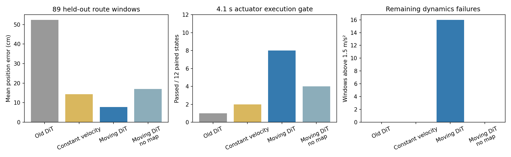

# 小批量厂区运动条件 DiT 微调（2026-10-06）

本轮实测显示短时预测与执行效果改善，但尚不足以部署为完整实时避障系统。实验严格保留失败；测试后没有修改参数或重新选权重。

## 数据与划分

固定 12 条公开任务路线：6 train、2 validation、4 test。全部专家通过采集验收，得到 103/30/89 个窗口。包括北向、西向直行、升降、正反向转弯。采用上一轮完整厂区三角网格、OMPL/COAL 专家、原执行器动力学和真实射线；每个窗口由官方 nvblox 重建最近 5 秒扫描的四帧历史。

这是 **within-factory route holdout**：所有路线属于同一个厂区，扫描和部分通道可能重叠，不能声称未见场景或空间严格隔离的泛化。按任务路线划分，同一路线的相邻窗口不跨集合。原 `FactoryWindowDataset` 的 mesh-level 防泄漏规则保持不变；新试验入口要求显式的 `within_factory_route_holdout_v1` 协议，报告同厂区评估。89 个重叠窗口也不是 89 个独立场景。

新采集附加每个决策窗口的完整 native qpos/qvel/act/time 和此前参考轨迹的 100 ms 延续片段，用于公平恢复物理状态。它们只供评估，不进入学生输入。

## 模型和训练

- 从旧 SDF checkpoint 初始化兼容的 DiT 参数，冻结并复用地图 CNN/历史编码器；不是所有参数从随机初始化训练。
- 条件为 17 维：当前公开目标 XYZ、实测线速度、机体系角速度、当前局部 wxyz、当前参考线加速度、执行延迟。
- 输出 8 个六维位姿样本，对应决策之后 0.6、1.1、…、4.1 s。以当前速度外推为基线，扩散预测残差。姿态为小角度局部 Euler，当前采集主要是位置与小姿态，不证明大姿态 SE(3) 操作能力。
- 五次样条解码固定当前测得的位置、速度及当前参考加速度；末端速度取最后两个预测点的差分，不强制在窗口结束停车。没有碰撞修路、控制点裁剪或专家回退。
- train-only 残差归一化；冻结地图特征预编码。随机种子 77，AdamW 2e-4，batch 16，2,000 步，EMA 0.99。损失包含 v-prediction、物理坐标重建和控制点二阶差分误差。
- 每 250 步按验证集六维控制点 MSE 选权重，选中 step 2000。这个选择量混合位置/小角度数值，最终效果使用单独的米制指标。测试数据没有用于训练、归一化或选权重。
- 对照：原冻结 SDF DiT 原有 20 秒静止起步契约；匀速外推；新 DiT；新 DiT 置空地图。旧模型的契约不同，因此旧/新差异不是纯架构消融；匀速基线提供更相关的运动中参考。置空地图只是同权重输入消融，没有单独重训。

## 结果

89 个测试窗口，未来 0.1–4.1 s 的位置误差：

| 方法 | 平均位置误差 ADE | 末端误差 FDE | 12 个配对物理状态通过数 |
|---|---:|---:|---:|
| 旧冻结 DiT | 52.43 cm | 92.75 cm | 1/12 |
| 匀速外推 | 14.30 cm | 39.92 cm | 2/12 |
| 新运动条件 DiT | **7.78 cm** | **19.70 cm** | **8/12** |
| 新 DiT，地图置空 | 17.05 cm | 49.80 cm | 4/12 |

新模型 ADE 相比匀速外推下降约 45.6%，相比旧模型下降约 85.2%。所有方法在物理回放中都没有触发厂区网格违规或 native 接触；通道较宽，不能据此证明碰撞率改善。

物理评估预先固定每条测试路线接近第 4 秒、中点和结束前 6 秒的三个窗口，共 12 个状态 × 4 方法。恢复相同完整 native 状态，先执行相同 100 ms 已有参考，再执行预测，合计 48 次、196,800 个物理步。外部 COAL 每个物理步检查完整 URDF 与厂区网格；不模拟厂区接触响应。

“通过”是短时专家进度门槛，不是整条任务完成率：末端距专家未来位置 <0.25 m、模型参考跟踪误差 <0.15 m、实测速度 <0.8 m/s、参考加速度 <1.5 m/s²，且完整执行、无碰撞违规。它没有放宽或替换现有在线运行时保护。事后用较严格的 0.65 m/s / 0.9 m/s² 复查，8 个新模型通过项仍全部满足。

新模型 P50/P95 轨迹生成耗时为 33.47/34.64 ms，包含编码、20 步 DDIM、CPU 样条解码和同步，排除预热；不含雷达、nvblox、IPC 和物理。不能把此数字直接称为端到端硬实时。微调优化循环约 16.1 s，另有数据准备和冻结特征预编码开销。

## 尚未解决的问题

新模型 16/89 个窗口的采样参考加速度超过 1.5 m/s²。配对物理回放中的四个失败保留：两个出现明显专家进度偏差，另外的转弯窗口出现速度/加速度超限（部分失败条件重叠）。没有因零碰撞或平均误差下降将它们改判为成功。

当前模型只有当前活动任务航点，没有后续多航点预览；跨转弯的未来标签可能需要当前输入未完整表达的任务意图。这是后续需要独立实验的局限，不能依据本轮测试集继续调参再沿用其测试身份。

后续优先增加提前减速和急转弯数据、训练时的时间导数/动力学约束，以及任务航点预览，再在新的冻结测试集上验证。暂不建议直接扩大到大量采集或接管完整工厂飞行。此次每段预测从专家状态起步，尚未验证模型反复重规划后的误差累积、工厂全程自主完成率或真实硬件。



## 代码、权重与复现

- 配置：`configs/moving_factory_pilot_v1.json`。
- 采集：`tools/collect_factory_dit_pilot.py`（最多两个独立 CPU 子进程；失败不重抽）。
- 模型/解码：`hnuter_dit/moving_sdf_model.py`、`moving_pose.py`。
- 建图/训练/预测：`hnuter_dit/moving_sdf_training.py`。
- 配对回放：`hnuter_dit/moving_sdf_evaluation.py`。
- 权重：`artifacts/moving_factory_pilot_v1/model/best.pt`；原权重未覆盖。
- 紧凑证据：`docs/moving_factory_dit_validation.json`；本地完整数据：`results/factory_dit_pilot_v1/`。

在模型仓库根目录执行，始终使用新目录：

```bash
PYTHONDONTWRITEBYTECODE=1 OMP_NUM_THREADS=1 OPENBLAS_NUM_THREADS=1 \
 /home/z017/research/curobo_env/bin/python tools/collect_factory_dit_pilot.py \
 --protocol configs/moving_factory_pilot_v1.json --output /tmp/moving-repeat/campaign
```

映射、训练、预测在已有 nvblox 镜像中运行；将 `/tmp/moving-repeat` 挂到 `/work`、当前模型仓库挂到 `/model`、仿真仓库只读挂到 `/sim`，设置 `PYTHONPATH=/model`、`OMP_NUM_THREADS=2`、`OPENBLAS_NUM_THREADS=1`、`LD_LIBRARY_PATH=/opt/nvblox-venv/lib/python3.12/site-packages/nvidia/npp/lib`，用 `/opt/nvblox-venv/bin/python` 执行：

```bash
-m hnuter_dit.moving_sdf_training prepare --root /work/campaign --sim-root /sim
-m hnuter_dit.moving_sdf_training train --root /work/campaign \
 --base /model/artifacts/static_sdf_pose_pilot_v1/models/sdf/best.pt --output /work/training --steps 2000
-m hnuter_dit.moving_sdf_training infer --root /work/campaign \
 --base /model/artifacts/static_sdf_pose_pilot_v1/models/sdf/best.pt \
 --checkpoint /work/training/best.pt --output /work/predictions
```

然后在主机原生 Python 中运行：

```bash
PYTHONDONTWRITEBYTECODE=1 OMP_NUM_THREADS=1 OPENBLAS_NUM_THREADS=1 \
 /home/z017/research/curobo_env/bin/python -m hnuter_dit.moving_sdf_evaluation \
 --root /tmp/moving-repeat/campaign --predictions /tmp/moving-repeat/predictions \
 --output /tmp/moving-repeat/physical
```

OMPL 几何与全部随机数跨版本不保证逐位复现；原始几何、任务协议、数据和 checkpoint 哈希保留。此为一次小量、单训练随机种子的实验。

相关新旧回归测试共 21 项通过；原始窗口、每次失败和所有配对回放结果均保留。
