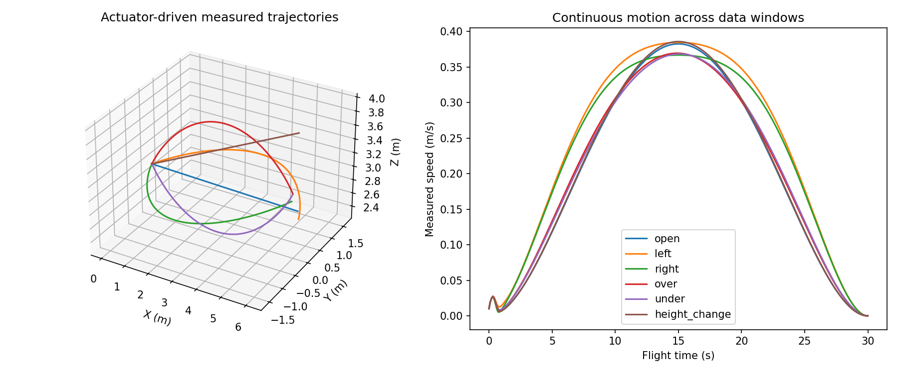

# Continuous three-dimensional navigation expert collection

This collector addresses the factory demo's forced sideways detours and stop-at-every-leg data convention. It produces a **new dataset schema**, not a new trained policy. The old static-SDF checkpoint and runtime are unchanged. All paths below are relative to HNUTER_DiT.

## What changes

- Six balanced scene types by episode index: open space, left passage, right passage, over an obstacle, under an obstacle, and a substantial height change. Scene seeds vary destination, yaw and obstacle X/width. Vertical barriers span 14 m laterally, so the tested vertical solutions are required within the candidate family rather than decorative height changes.
- The privileged teacher scores a straight candidate and 20 horizontal/vertical detours. It selects the shortest feasible candidate with a small squared-jerk penalty, rather than requiring a side arc. Feasibility requires sampled sphere clearance of 0.22 m, speed at most 0.7 m/s, acceleration at most 0.9 m/s², followed by actuator-driven physical validation.
- Each 30-second reference is one continuous polynomial trajectory, with zero velocity/acceleration only at the whole-flight endpoints. No stop, hold, state reset or replan occurs at dataset-window boundaries.
- Windows begin at flight times 2, 4, …, 26 s. Each has four real moving MID-360 scans separated by 0.2 s, actual position, quaternion, linear/body angular velocity, and the current commanded acceleration. The last quantity is explicitly a **reference**, not measured acceleration.
- The target is an 81-sample, 4-second future reference at 0.05 s spacing. Future position is relative to the current measured position; quaternion is world wxyz, linear derivatives are world-frame, and angular derivatives are body-frame. The initial reference can differ from the measured state by the recorded tracking error: labels are not silently snapped to measurements.
- Whole episodes are assigned deterministically to approximately 70/20/10 train/validation/test splits. All overlapping windows of one episode stay together. These are probabilistic proportions, not exact quotas; six episodes are a smoke test, not a complete training corpus.

## Actual nvblox observations

Collection uses the original HNUTER actuators/controller in native MuJoCo at 1 ms, plus actual ray intersections against the scene collision geometry. The default is 20,000 rays per scan. It saves all 151 scans per complete flight and real synchronized sensor poses. No preset point cloud or box voxelization substitutes for sensor measurements.

`prepare` runs the existing pinned official nvblox CUDA implementation. For each decision window it resets the map, anchors the grid at the **current measured** aircraft position, and integrates only its four preceding scans in timestamp order. All four snapshots share that anchor. It retains the existing six channels and unknown masks on a 32³, 0.25 m query grid. Fields are stored in float16; age embeddings preserve actual timestamps. This is a causal four-scan local map, not accumulated global SLAM; unknown space is not declared free. Known fractions are recorded, not used to conceal sparse observations.

Boxes and scene-kind labels stay in the expert/evaluator manifest; they are absent from the student window files. Future references are supervised labels, never map inputs. Preparing the test split does not authorize fitting normalization or training on it.

## Run

```bash
# Run from HNUTER_DiT. A new output directory is required.
PYTHONDONTWRITEBYTECODE=1 OMP_NUM_THREADS=1 OPENBLAS_NUM_THREADS=1 \
 /home/z017/research/curobo_env/bin/python -m hnuter_dit.sdf_navigation_data collect \
 --sim-root /home/z017/research/isaacsim-industrial-reactor \
 --output results/navigation_collection/smoke --count 6 --seed 20261006

# Use --count 120 (or another multiple of six) to expand after inspecting failures.
# Same seed/index reproduces the same scene; a new seed gives an independent corpus.
docker run --rm --gpus all --ipc=host \
 --mount "type=bind,source=$PWD,target=/dit" \
 --mount type=bind,source=/home/z017/research/isaacsim-industrial-reactor,target=/sim,readonly \
 -e LD_LIBRARY_PATH=/opt/nvblox-venv/lib/python3.12/site-packages/nvidia/npp/lib \
 -e PYTHONDONTWRITEBYTECODE=1 --workdir /dit \
 --entrypoint /opt/nvblox-venv/bin/python isaaclab-sim:6.0.0-nvblox \
 -m hnuter_dit.sdf_navigation_data prepare --sim-root /sim \
 --source results/navigation_collection/smoke --output results/navigation_collection/smoke_mapped
```

Collection records every requested outcome in `collection.json` and never redraws failed episodes. Incomplete collection is rejected by `prepare`. Only physically accepted episodes produce mapped training windows; rejected IDs remain in `mapping.json`. Hashes connect each mapped file to its raw episode and collection manifest. Existing outputs are never overwritten.

Student window files contain `fields`, `ages`, `current_quaternion`, `current_velocity`, `current_angular_velocity`, `current_reference_acceleration`, `goal`, `future`, `future_times`, `origin`, `stamp`, `scene_id`, `split`. The six previous stationary free-control targets are deliberately not reused: training must condition on the moving state and predict future trajectories with compatible initial derivatives. Feeding these windows directly to the old stationary-start trainer is unsupported.

## Scope

The teacher has full scene geometry; the student has causal sensing. The finite candidate family is not a general global planner: complex mazes, mixed lateral/vertical maneuvers and arbitrary multiple task waypoints may fail. Geometry clearance and motion maxima are sampled checks, not continuous mathematical certificates; physical contact is checked every 1 ms. This iteration varies yaw only, with zero commanded roll/pitch, and does not collect contact tasks or attitude-dependent narrow passages. It establishes continuous 3-D navigation data, not a proven learned moving-start replanner or a performance improvement of a retrained DiT.

Validation results are recorded in `docs/nvblox_navigation_collection_validation.json`.

## Validated smoke run (2026-10-06)

Six attempted episodes passed, producing 78 moving windows and 906 real 20,000-ray scans.
Across 180,000 flight physics steps there were zero robot/environment contacts; maximum
position tracking error was 0.01681 m. Every window had nonzero measured velocity
(minimum 0.02372 m/s). The open scene selected zero detour; required over/under scenes
selected positive/negative vertical detours. These six scenes are not a generalization statistic.

All 78 windows were mapped by the official GPU nvblox implementation and checked for
file hashes, finite tensors, causal history, split consistency and unknown preservation.
Latest-grid known fractions ranged from 4.97% to 16.70%; the rest remains explicitly
unknown. Six focused unit tests passed. Raw episodes and mapped windows are retained
locally in `results/navigation_collection/validated_v1` and `mapped_v1`, respectively,
and are ignored by Git. Collection uses 5 Hz scans for the 0.2-second training history;
it does not claim a 10 Hz wall-clock benchmark. Acceptance currently checks collision,
completion and position tracking, not a separate attitude-error threshold.


