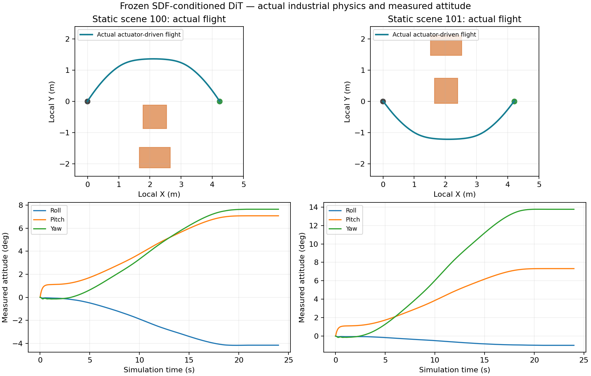

# Static obstacles: GPU distance-field history and learned pose trajectories

录像与分段性能分析追加见 [STATIC_SDF_DEMO.md](STATIC_SDF_DEMO.md)。

## 本轮最终实测（2026-10-04）

已实现 **MID-360 实测回波 → 官方 nvblox GPU TSDF/ESDF → 局部距离场与短期观测历史编码 →
DiT → XYZ 与 roll/pitch/yaw 连续位姿样条 → 原 SE(3) 执行器控制**。两轮各采集 96 条
专家轨迹并各从头训练 2,000 步；最终采用背景随机化的第二轮权重。首轮工业迁移失败
以及中间运行入口失败均保留在证据中，没有改判为成功。

| 最终权重验证 | 结果 |
| --- | --- |
| 新的 16 个独立测试场景，原执行器物理回放 | **16/16 到达目标位姿，0 接触**；无保护器或轨迹修补 |
| 同权重移除地图 | 8/16 到达；另外 8 场发生真实接触 |
| 直线参考 | 0/16 到达；16 场发生真实接触 |
| 仅最新观测，离线几何检查 | 16/16；本轮静态课程未证明历史优于单帧 |
| 工业新布置 100 / 101 | **2/2 到达，各 24,000 个真实物理步，0 接触**；各仅一次 DiT 采样，无重试、无保护干预 |
| 工业终点位置 / 姿态误差 | 1.57 / 1.58 cm；约 1.00° / 1.00° |
| 最终原生持续感知飞行 96 / 97 | 各 24 秒仿真约 24.0002 秒墙钟，均无接触到达，240 帧无丢帧，无 100 ms 响应超时 |
| 回归 | **175 项通过** |

工业场景在初始历史积累之后，采样间隔中位数约 100 ms；包含射线采集、IPC、建图和
观测检查的响应 P95 为 **36.99 / 36.72 ms**。首次完整规划响应为 **99.83 / 97.28 ms**，
其中 DiT 推理 **51.23 / 55.86 ms**。实际处理完成的地图更新间隔 P95 为
**113.93 / 112.09 ms**，最大 **146.39 / 124.63 ms**，因此这是有抖动的实时感知原型，
不是每个周期都严格满足 100 ms 的硬实时保证。两场分别因有界背压丢弃 55 / 36 次
重复/相邻提交；未知区域依然不被认证为空闲。

工业循环的 24 秒仿真分别用了 **52.02 / 50.89 秒墙钟**，完整 Isaac 物理循环仍不实时。
初始物理 CUDA 加载阶段也出现秒级响应；原始报告保留最大值，没有只报告预热后的
数字。独立原生物理测试的完整响应 P95 约 22 / 23 ms，可维持墙钟节拍。



图中轨迹来自实际物理状态；平面图只画出新增测试障碍，完整工业环境仍参与真实碰撞
检测。当前结论限于已测的静态、小姿态、静止起步课程，不能推广为任意厂区的无碰撞保证。

This is a small static-obstacle pilot, extending the [geometry comparison](GEOMETRY_ENCODER_PILOT.md)
and [latency analysis](GEOMETRY_LATENCY.md). It trains a new DiT on physically validated expert
trajectories. Old box/point/occupancy checkpoints and the simulator's controller are unchanged.

## Implemented data path

Measured MID-360 approximation returns and simultaneous physical sensor poses enter an isolated
worker running the pinned official nvblox wheel. That worker integrates TSDF, updates ESDF and
queries a bounded local tensor on CUDA. The tensor passes directly to the learned encoder and
DiT on the same GPU/process. Dense fields are never exported through the runtime IPC boundary:
only scans enter and small pose-spline coefficients leave.

- nvblox map voxel size: 0.15 m; 20 m integration range; 5 m ESDF propagation limit.
- Network query grid: 32³ at 0.25 m spacing; local bounds X [-2,6], Y/Z [-4,4] m.
  The grid stays at the planning anchor during a flight; it is not a moving global SLAM map.
- Six channels: clipped TSDF, log integration weight, clipped ESDF, ESDF-known flag,
  TSDF-observed flag, latest measured surface hits. Unknown distance values have explicit flags
  and are not labelled free space. The hit channel supplements the native distance fields.
- Four cumulative map snapshots at 0.2 simulation-second intervals, with physical age embeddings.
  Each snapshot contains only observations available at its timestamp. All snapshots share the
  measured planning-anchor frame; no future geometry or expert route is a student input.
- A small 3D CNN produces 64 tokens per snapshot, followed by a history Transformer and the
  existing project's DiT blocks: width 128, four blocks, four heads, 20-step DDIM inference.

The short history describes changing **observations**, not moving obstacles. This branch assumes
static geometry. Runtime continues integrating measured scans as the aircraft moves, while the
initial learned reference executes.

Runtime snapshots retain their actual acquisition ages under asynchronous sampling. The newest
integrated observation replaces the last history entry at inference; unordered history, gaps
over 0.4 s or a total span over 1 s are rejected. Training uses regular 0.2 s gaps. This bounded
jitter handling does not establish dynamic-obstacle prediction capability.

## Six-degree-of-freedom output

The new checkpoint predicts six free controls with six components each: XYZ and local XYZ Euler
angles. These form a 12-control cubic spline with a fixed 20 s time axis. Three repeated start
controls and three repeated goal controls enforce the requested endpoint poses and zero endpoint
velocity/acceleration. Endpoint constraints are mathematical conditioning, not a supplied route.
Intermediate translations and attitudes are learned. Angular velocity and angular acceleration
are converted analytically into body coordinates; all samples drive the unchanged geometric
controller's real actuators.

This pilot is restricted to stationary starts, forward routes of approximately 4.2–4.6 m, small
height changes and modest attitudes (training goal roll/pitch within ±0.12 rad, yaw within
±0.35 rad). A runtime sanity bound of 0.7 rad is not evidence of training across that wider range.
It does not demonstrate large-rotation SO(3) planning, attitude-dependent narrow-gap maneuvers,
moving-start replanning, or contact tasks.

## Expert collection and training protocol

The initial pilot used 96 independent static scenes, seed 811; 64 training, 16 validation and 16 held-out test scenes.
Scenes vary obstacle side, dimensions, position, goal distance, height and all three target angles.
A second static barrier makes the blocked side harder to traverse. Other walls and the ground
provide measured context. Scene IDs and side labels never enter the network.

The expert searches smooth left/right detours against complete geometry, requires 0.22 m
collision-sphere clearance, then executes each accepted reference for 20,000 actual 1 ms MuJoCo
steps. All 96 accepted experts have zero robot/environment contacts and satisfy pose tracking
criteria. The teacher may know geometry; the student's map is built exclusively from four measured
20,000-ray scans taken during the initial 0.6 s hold. Dataset and scan hashes are archived.

The initial short-route collection exposed insufficient terminal tail clearance for some expert
scenes. Before model training, the curriculum's route length was revised to 4.2–4.6 m and the
entire 96-scene collection was regenerated. Failed preflight logs remain in local results. No
held-out model result was used for that change.

All network weights are trained from scratch: seed 29, 2,000 steps, batch 16, AdamW at 3e-4,
EMA 0.99, 100-step cosine diffusion schedule with velocity prediction. Only training rows fit
normalization or gradients. Every 250 steps, validation selects the checkpoint by safe/feasible
count, then coefficient error. Step 2,000 was selected before test evaluation. No larger training
run or test-based weight selection was performed.

An industrial development placement (97) exposed a domain-transfer failure: the initial model's
detour was too small and measured ESDF rejected it. Four additional learned candidates also failed;
their trajectories were not manually repaired or executed. A second, equal-size curriculum was
therefore collected with seed 919: far wall distance/open backgrounds and non-route clutter are
randomized independently of route side. This is an adaptive follow-up, not a controlled architecture
comparison. It again has 64/16/16 independent scenes and all 96 experts pass actuator-driven
collision/pose validation. The second network is trained **from scratch**, seed 31, with the same
2,000-step budget and validation-only checkpoint selection. Its independent test set and new
industrial fixture placements 100/101 are reported separately. The initial weight, its test
results and every failed industrial attempt are retained; test scenes are never added to training.

## Evaluation boundaries

Raw learned trajectories, map-removed predictions and straight references are evaluated without
path repair or a safety guard against original HNUTER collision geometry at every physics step.
Negative trials stop at first contact and are recorded as failures. The latest-only history
intervention is an offline geometric diagnostic; it is not separately retrained.

The online planner additionally checks observed ESDF clearance along robot collision spheres and
stops on stale perception, failed workers or invalid motion bounds. Unknown regions remain
uncertified. Passing this partial guard is not a collision certificate; actual contacts and pose
arrival are independently recorded. First-failure industrial runs remain part of the evidence.

At least 5% of the sampled sphere-center queries must have observed distance support to accept
a candidate. This is only a minimum-support gate; it does not certify the remaining unknown
space. If the first sample is infeasible or has an observed violation/insufficient support, four
additional DiT samples are checked against the same measured map. A feasible candidate with no
observed violation is selected by its observed clearance; none of its controls are edited.
After a rejection, the stationary aircraft may accumulate new measurements and retry at most
three times with at least one simulation second between attempts. Rejections, attempts, inference
cost and interventions remain visible in the report.

The pilot requests a trajectory after four causal snapshots and continues real sensing during
execution. It does not replace an accepted trajectory while moving. Global pose comes from
simulation truth; the sensor is the project's ideal MID-360 approximation, not hardware LiDAR
or laser odometry. Static test success does not establish arbitrary industrial-scene generalization.

## Reproduce

The model repository and `/home/z017/research/isaacsim-industrial-reactor` are separate dependencies.
Use the existing `isaaclab-sim:6.0.0-nvblox` image; do not replace Isaac's Torch. Raw datasets and
logs are local ignored results, so a clone requires recollection to repeat training.

```bash
# Original-controller expert collection on the installed CPU MuJoCo environment.
OPENBLAS_NUM_THREADS=1 OMP_NUM_THREADS=1 \
  /home/z017/research/curobo_env/bin/python -m hnuter_dit.sdf_data \
  --output results/static_sdf/repeat_collection --count 96 --seed 919 --workers 6 \
  --background-randomization

# Actual industrial scene, static evaluation fixture, same frozen model.
./run_industrial.sh --headless --mode sdf \
  --sdf-checkpoint artifacts/static_sdf_pose_pilot_v1/models/sdf/best.pt \
  --sdf-scene-index 100 --duration 24 --max-speed .65 --max-acceleration .9 \
  --seed 23 --real-time --output results/static_sdf/repeat_industrial100
```

For mapping/training, run the following container prefix from this repository, appending the
indicated module arguments. Always choose new output directories.

```bash
docker run --rm --gpus all \
  --mount "type=bind,source=$PWD,target=/dit" \
  --mount type=bind,source=/home/z017/research/isaacsim-industrial-reactor,target=/sim,readonly \
  -e LD_LIBRARY_PATH=/opt/nvblox-venv/lib/python3.12/site-packages/nvidia/npp/lib \
  -e PYTHONDONTWRITEBYTECODE=1 -e OPENBLAS_NUM_THREADS=1 -e OMP_NUM_THREADS=2 \
  --workdir /dit --entrypoint /opt/nvblox-venv/bin/python isaaclab-sim:6.0.0-nvblox \
  -m hnuter_dit.sdf_training prepare \
  --source results/static_sdf/repeat_collection --output results/static_sdf/repeat_mapped
```

Replace module arguments with `-m hnuter_dit.sdf_training train --source
results/static_sdf/repeat_mapped/dataset.npz --output results/static_sdf/repeat_training --steps 2000 --seed 31`
for training. `hnuter_dit.sdf_evaluation infer` performs frozen held-out inference and
`hnuter_dit.sdf_evaluation native` runs actuator-driven physical comparisons. For a wall-clock-paced
native flight, use `/isaac-sim/python.sh` as container entrypoint and module `hnuter_dit.sdf_live`,
with `--checkpoint`, `--output` and `--index 96` (or 97).

Industrial sensing runs every 0.1 simulation seconds or 0.1 wall seconds, whichever is reached
first. Sensor CUDA kernels are warmed using a separate sensor instance without advancing physics;
the formal sensor's timestamps remain strictly increasing. Warm-up duration is reported separately.
The worker uses bounded backpressure and reports dropped submissions. Timing distinguishes
initialization, steady sensing, single inference and the more expensive fallback candidates.

## Source and evidence

Implementation: `sdf_mapping.py`, `sdf_model.py`, `sdf_pose.py`, `sdf_data.py`, `sdf_training.py`,
`sdf_evaluation.py`, `sdf_runtime.py`, `sdf_worker.py`, `sdf_online.py`, `sdf_live.py` in `hnuter_dit/`.
`industrial_runner.py` adds an explicit SDF mode and evaluator-only static obstacles. The IPC base
adds an environment hook so the SDF worker can use the pinned NPP library without altering other
workers. The simulation repository and original controller remain unchanged.

Final aggregate results and provenance are in [static_sdf_pose_validation.json](static_sdf_pose_validation.json)
and [the frozen artifact](../artifacts/static_sdf_pose_pilot_v1/README.md). Timing distinguishes sensor
acquisition, GPU mapping, model inference, IPC response and the complete physics loop. A slow
simulation must not be described as globally real time merely because mapping is fast.
